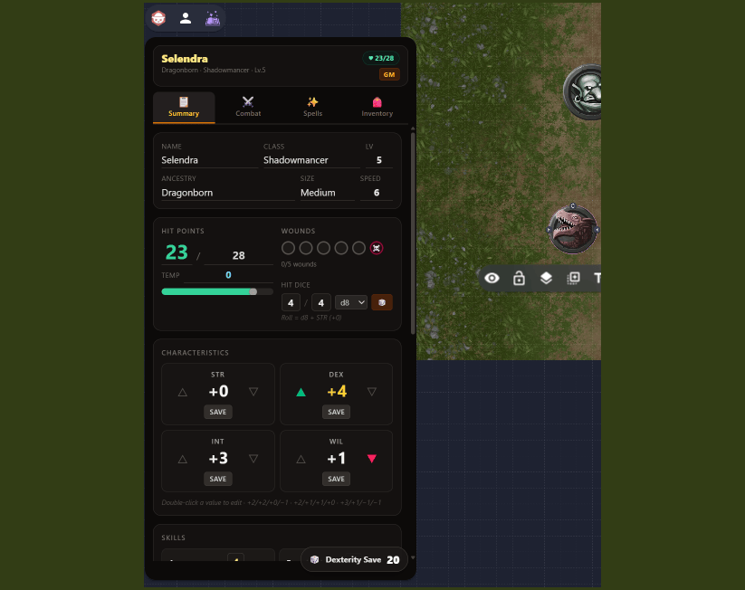
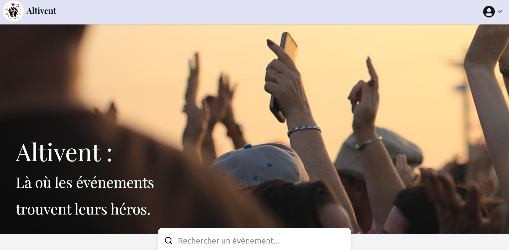
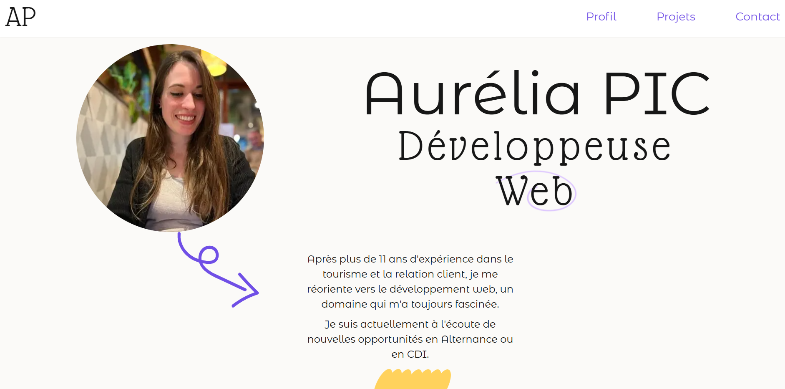

# Hi there 👋 I'm Aurélia 🤗
 

  

### 💃🏻 About Me
Fullstack JS developer with a soft spot for frontend and product thinking.
I love taking a project from the first User Story all the way to production.

Before code, I spent **11 years in hospitality**: front desk manager, team management, project lead for the EU Ecolabel renewal, and the go-to person for anything IT. That background shapes how I build: user first, pragmatic, and calm when things break.

Coding since **early 2024**, with real production experience on React / NestJS / AWS projects. Curious by nature, always learning something new.

### 🚀 What I've been working on
- 🎲 **Nimble**: real-time synced character sheet extension for Owlbear Rodeo, published on the official store. Built with an **AI-augmented workflow**: specs split into batches, implementation delegated to Claude Code with injected context, systematic review of every output, Vitest tests validated by mutation testing.
- 🤝 **Altivent** (Alt Immersion): open-source app connecting event organizers and volunteers. React, NestJS, MongoDB microservice with NATS, Stripe payments, Jest & Cypress tests, GitLab CI/CD, Docker, AWS.
- 💼 **Freelance**: backend & frontend reinforcement on a SaaS launch (Next.js, NestJS, Prisma, PostgreSQL, Stripe), and a Next.js showcase site scoring **98 performance / 100 SEO** on Lighthouse.

### 🌱 Currently learning
LLM APIs · MCP · RAG · Agentic tools · AI-augmented engineering

### 🌐 Socials
 

### 💻 Tech Stack

**Frontend** 
        

**Backend** 
      

**Databases** 
    

**Testing** 
   

**DevOps & Cloud** 
     

**Tools** 
    
  

<!-- Projects -->
<h1 align="center">My latest projects 👨‍💻</h1>

  <table>
    <tr>
      <td width="50%">
        <h3 align="center">Nimble 🎲</h3>
        

          
        

        
Real-time character sheet extension for Owlbear Rodeo

        

          
<b>Note 📝</b>

          React, TypeScript, OBR SDK & Vitest (mutation testing). Built with an AI-augmented workflow using Claude Code.
        

      </td>
      <td width="50%">
        <h3 align="center">Altivent 🤝</h3>
        

          
        

        
Open-source app connecting event organizers and volunteers

        

          
<b>Note 📝</b>

          React, NestJS, MongoDB microservice with NATS, Stripe, Jest & Cypress, GitLab CI/CD, Docker & AWS.
        

      </td>
    </tr>
    <tr>
      <td width="50%">
        <h3 align="center"><a href="https://www.aureliapic.fr/" target="_blank" rel="noreferrer">Portfolio 🌸</a></h3>
        

          
        

        
My deployed portfolio

        

          
<b>Note 📝</b>

          Next.js, TypeScript, Tailwind & GSAP.
        

      </td>
      <td width="50%">
        <h3 align="center">Pokédex Team Rocket 📱</h3>
        

          
        

        
Interactive Pokédex app

        

          
<b>Note 📝</b>

          React Native, TypeScript, Express & SQLite.
        

      </td>
    </tr>
    <tr>
      <td width="50%">
        <h3 align="center">Renardor's Revenge 🦊</h3>
        

          <video src="https://github.com/user-attachments/assets/6dc90891-3333-4596-baa5-99cc14ce4c6c"></video>
        

        
Tower defense game

        

          
<b>Note 📝</b>

          Unity & C#.
        

      </td>
      <td width="50%">
        <h3 align="center">Chemin Montessori 👼🏼</h3>
        

          
        

        
Montessori workshop sales site

        

          
<b>Note 📝</b>

          React.js & Node.js/Express.js.
        

      </td>
    </tr>
    <tr>
      <td width="50%">
        <h3 align="center"><a href="https://cyber-mart.netlify.app/" target="_blank" rel="noreferrer">CyberMart 📎</a></h3>
        

          
        

        
Back to the future in the 90's!

        

          
<b>Note 📝</b>

          React & Node.js.
        

      </td>
      <td width="50%">
        <h3 align="center"><a href="https://univers-de-blibli.netlify.app/" target="_blank" rel="noreferrer">L'univers de Blibli 🌱</a></h3>
        

          
        

        
Tribute to Studio Ghibli. Mini-games and library.

        

          
<b>Note 📝</b>

          React & Node.js/Express.js, GSAP for animations.
        

      </td>
    </tr>
  </table>

 

### 📊 GitHub Stats

